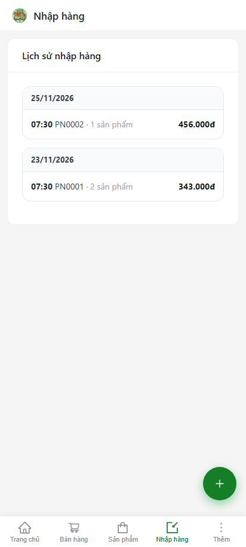
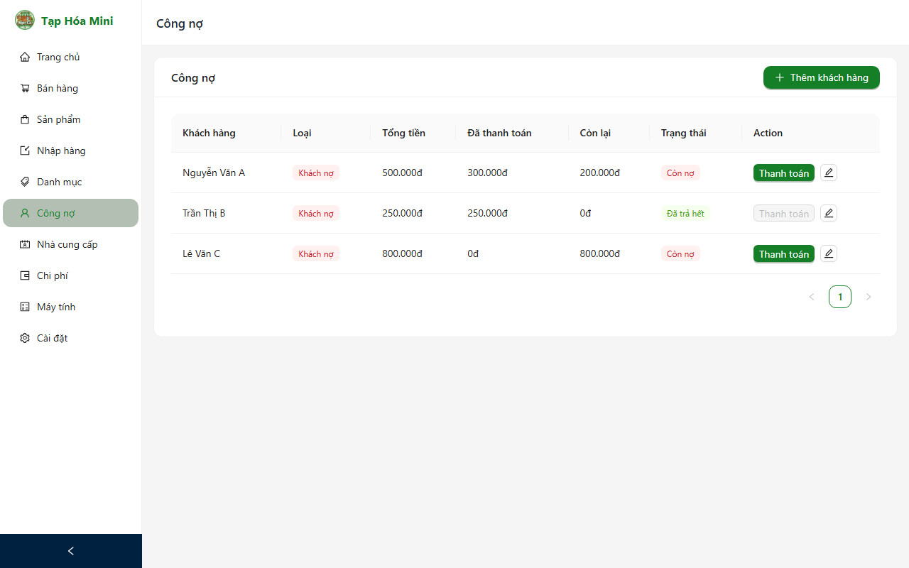

<p align="center">
  
</p>

<h1 align="center">Tạp Hóa Mini</h1>

<p align="center">
  Ứng dụng quản lý tạp hóa nhỏ: bán hàng, nhập hàng, tồn kho, công nợ và sao lưu dữ liệu.<br />
  Chạy trên trình duyệt, đóng gói được thành app Android.
</p>

<p align="center">
  
  
  
  
</p>

<p align="center">
  
</p>

> 💡 **Offline-first:** toàn bộ dữ liệu lưu trên thiết bị. Không cần server, không cần tài khoản, không cần internet.

---

## ✨ Điểm nổi bật

- 🧾 **Bán hàng nhanh:** chọn sản phẩm theo danh mục hoặc quét mã vạch, tính tiền tự động.
- 💰 **Xử lý tiền thừa linh hoạt:** trả lại, cho (tặng) hoặc ghi nợ khi khách đưa dư.
- 📦 **Tồn kho tự động:** nhập hàng tự tăng tồn, bán hàng tự giảm, cảnh báo khi sắp hết.
- 👥 **Quản lý công nợ:** theo dõi khách đang nợ và số tiền đã trả.
- 🔐 **Bảo mật bằng PIN:** mã PIN được băm PBKDF2-SHA256, không lưu dạng rõ.
- 💾 **Sao lưu và khôi phục:** xuất toàn bộ dữ liệu ra file JSON, có kiểm tra hợp lệ trước khi ghi đè.

---

## 📸 Xem nhanh giao diện

<table>
  <tr>
    <td align="center" width="50%">
      <br />
      <b>Bán hàng</b>: chọn sản phẩm nhanh theo danh mục
    </td>
    <td align="center" width="50%">
      <br />
      <b>Sản phẩm</b>: giá nhập, giá bán, tồn kho
    </td>
  </tr>
  <tr>
    <td align="center" width="50%">
      <br />
      <b>Nhập hàng</b>: lịch sử các phiếu nhập
    </td>
    <td align="center" width="50%">
      <br />
      <b>Công nợ</b>: khách đang nợ và số đã trả
    </td>
  </tr>
</table>

---

## 📋 Tính năng đầy đủ

| Nhóm | Chức năng |
| --- | --- |
| 🏠 Tổng quan | Trang chủ với thống kê và xu hướng doanh thu so với hôm qua |
| 🧾 Bán hàng | Tạo đơn bán, tính tiền khách đưa, xem lịch sử giao dịch |
| 📦 Sản phẩm | Quản lý sản phẩm, ảnh, mã hàng, quét mã vạch, cảnh báo hạn sử dụng |
| 🏷️ Danh mục | Phân loại sản phẩm |
| 📥 Nhập hàng | Phiếu nhập theo đơn lẻ hoặc theo thùng, tự cập nhật tồn kho |
| 👥 Công nợ | Theo dõi khách nợ và số tiền đã trả |
| 🤝 Nhà cung cấp | Danh bạ nhà cung cấp |
| 💸 Chi phí | Ghi nhận chi phí vận hành |
| 🧮 Máy tính | Máy tính nhanh tích hợp |
| 🔔 Thông báo | Thông báo cục bộ: tồn kho thấp, sắp hết hạn, biến động doanh thu |
| 🔐 Bảo mật | Khoá ứng dụng bằng mã PIN |
| 💾 Sao lưu | Xuất / khôi phục dữ liệu bằng file JSON |

---

## 🚀 Bắt đầu nhanh

Nếu đã có Node.js 20 trở lên:

```bash
git clone https://github.com/thiennguyenk01/mini-grocery.git
cd mini-grocery
npm install
npm run dev
```

Mở `http://localhost:5173` trên trình duyệt. Dữ liệu mẫu sẽ có sẵn để bạn dùng thử.

---

## 🛠️ Hướng dẫn cài đặt chi tiết

### Yêu cầu

| Phần mềm | Phiên bản | Ghi chú |
| --- | --- | --- |
| Node.js | 20 trở lên (đã kiểm tra với 24) | Kèm npm |
| Git | Bất kỳ | Để clone repo |
| Android Studio | Mới nhất | Chỉ cần nếu muốn build APK |

### Bước 1: Clone repository

```bash
git clone https://github.com/thiennguyenk01/mini-grocery.git
cd mini-grocery
```

### Bước 2: Cài đặt thư viện

```bash
npm install
```

Lệnh này cài toàn bộ dependencies trong `package.json` vào `node_modules/`.

### Bước 3: Chạy chế độ phát triển

```bash
npm run dev
```

Mở trình duyệt tại địa chỉ hiển thị trong terminal (thường là `http://localhost:5173`).

### Bước 4: Kiểm tra bản build production (tuỳ chọn)

```bash
npm run build
npm run preview
```

`npm run build` kiểm tra kiểu TypeScript rồi đóng gói ra `dist/`. `npm run preview` chạy thử bản đã đóng gói.

### Bước 5: Đóng gói ra Android (tuỳ chọn)

1. Cài [Android Studio](https://developer.android.com/studio).
2. Chạy lệnh sau để build web, đồng bộ sang project Android và mở Android Studio:

   ```bash
   npm run android
   ```

3. Trong Android Studio, chọn thiết bị hoặc emulator rồi nhấn **Run ▶**.

Khi chỉnh sửa code web, chạy `npm run android:sync` để đồng bộ lại vào project Android.

---

## 🎬 Thử nghiệm luồng chính

Sau khi chạy `npm run dev`, bạn có thể làm theo thứ tự sau:

1. **Thêm danh mục.** Vào **Danh mục**, tạo ít nhất một danh mục (ví dụ: *Đồ uống*).
2. **Thêm sản phẩm.** Vào **Sản phẩm**, nhấn **+** rồi nhập tên, đơn vị (gói, chai, kg...), giá nhập, giá bán, danh mục, ngưỡng cảnh báo và ảnh (tuỳ chọn). Trên Android có thể quét mã vạch.
3. **Nhập hàng.** Vào **Nhập hàng**, tạo phiếu nhập cho sản phẩm vừa thêm. Chọn nhập lẻ hoặc theo thùng. Tồn kho tự tăng sau khi lưu.
4. **Bán hàng.** Vào **Bán hàng**, thêm sản phẩm vào giỏ, nhập số tiền khách đưa:
   - Khách đưa đủ: đơn hoàn tất.
   - Khách đưa thiếu: phần còn lại được ghi vào **Công nợ**.
   - Khách đưa dư: chọn **trả lại** tiền thừa, **cho** (tặng) phần dư, hoặc **ghi nợ** để cửa hàng nợ lại khách.
5. **Xem công nợ và lịch sử.** Vào **Công nợ** để xem khách nợ, hoặc nhấn **Lịch sử giao dịch** trong trang Bán hàng.
6. **Xem thống kê.** Quay lại **Trang chủ** để xem doanh thu và xu hướng so với hôm qua.
7. **Đặt mã PIN.** Vào **Cài đặt → Bảo mật** để đặt PIN. Lần mở app sau sẽ yêu cầu nhập PIN.
8. **Sao lưu.** Vào **Cài đặt** để xuất file JSON. Khi cần, dùng chức năng khôi phục để nạp lại dữ liệu.

---

## 🧰 Công nghệ

- **Frontend:** React 19, TypeScript, Vite 8, Ant Design 6, React Router 7 (HashRouter), dayjs
- **Mobile:** Capacitor 8 (Android), `@capacitor-mlkit/barcode-scanning` cho quét mã vạch
- **Công cụ:** oxlint

---

## 🗂️ Cấu trúc thư mục

```
tap-hoa-mini/
├── android/              # Project Android (Capacitor)
├── docs/screenshots/     # Ảnh chụp màn hình dùng trong README
├── public/               # Tài nguyên tĩnh
├── src/
│   ├── components/       # Thành phần UI dùng lại (modal, nhập tiền, PIN...)
│   ├── hooks/            # Custom hooks (quét mã vạch, nút back Android...)
│   ├── layouts/          # Layout chính, thanh điều hướng, danh sách menu
│   ├── mock/             # Dữ liệu mẫu ban đầu
│   ├── pages/            # Các trang chức năng
│   ├── services/         # Sao lưu, PIN, thông báo, migration dữ liệu
│   ├── store/            # Context quản lý state toàn app
│   ├── types/            # Kiểu dữ liệu TypeScript
│   └── utils/            # Hàm tiện ích (định dạng, hạn sử dụng, tính tiền...)
├── website/              # Trang giới thiệu tĩnh
├── capacitor.config.ts   # Cấu hình Capacitor (appId, appName)
└── vite.config.ts        # Cấu hình Vite
```

---

## 📜 Các lệnh npm

| Lệnh | Tác dụng |
| --- | --- |
| `npm run dev` | Chạy server phát triển |
| `npm run build` | Kiểm tra TypeScript và đóng gói production |
| `npm run preview` | Xem thử bản đã đóng gói |
| `npm run lint` | Kiểm tra code bằng oxlint |
| `npm run android` | Build web, sync và mở Android Studio |
| `npm run android:sync` | Build web và sync sang project Android |

---

## ❓ Xử lý sự cố

- **`npm install` lỗi:** xoá `node_modules/` và `package-lock.json` rồi chạy lại, hoặc kiểm tra phiên bản Node.js.
- **Cổng 5173 đang bị chiếm:** Vite sẽ tự chọn cổng khác và hiển thị trong terminal.
- **Dữ liệu biến mất:** dữ liệu nằm trong localStorage của trình duyệt hoặc WebView. Xoá dữ liệu trình duyệt hoặc gỡ app sẽ xoá dữ liệu. Hãy sao lưu thường xuyên.
- **Quét mã vạch không hoạt động:** tính năng này cần chạy trên thiết bị Android thật, không hỗ trợ trong trình duyệt.

---

## 📄 Giấy phép

Dự án chưa khai báo giấy phép. Liên hệ chủ repository trước khi sử dụng lại mã nguồn.
