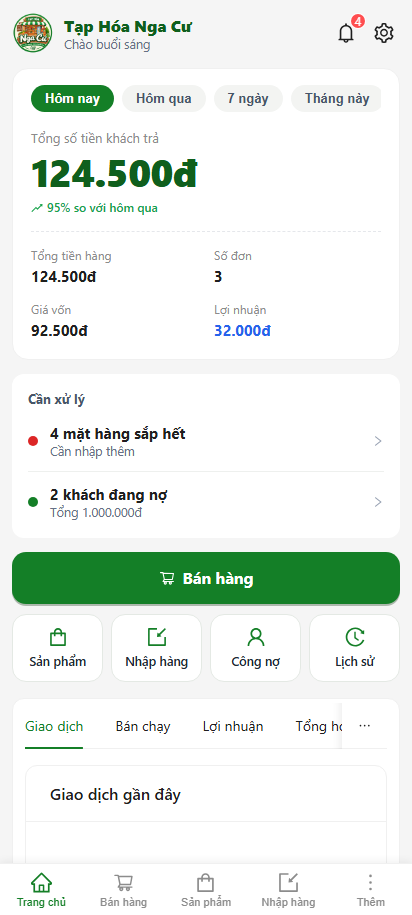

<p align="center">
  
</p>

<h1 align="center">Tap Hoa Mini</h1>

<p align="center">
  A mobile app for managing a small grocery store: sales, purchases, inventory, customer debts, and data backup.<br />
  Built for Android.
</p>

<p align="center">
  <b>English</b> · <a href="README.vi.md">Tiếng Việt</a>
</p>

<p align="center">
  
  
  
  
</p>

<p align="center">
  
</p>

> 💡 **Offline-first:** all data stays on the device. No server, no account, no internet connection required.

---

## ✨ Highlights

- 🧾 **Fast checkout:** pick products by category or scan a barcode, and the total is calculated automatically.
- 💰 **Flexible change handling:** when a customer overpays, return the change, give it as a gift, or record it as credit.
- 📦 **Automatic stock:** purchases increase stock, sales decrease it, and low-stock items are flagged.
- 👥 **Debt tracking:** see which customers owe money and how much they have paid.
- 🔐 **PIN lock:** the PIN is hashed with PBKDF2-SHA256 and never stored in plain text.
- 💾 **Backup and restore:** export all data to a JSON file, with validation before anything is overwritten.

---

## 📸 Screenshots

<table>
  <tr>
    <td align="center" width="25%">
      <br />
      <b>Sales</b><br />pick products quickly by category
    </td>
    <td align="center" width="25%">
      <br />
      <b>Products</b><br />purchase price, selling price, stock
    </td>
    <td align="center" width="25%">
      <br />
      <b>Purchases</b><br />history of purchase orders
    </td>
    <td align="center" width="25%">
      <br />
      <b>Debts</b><br />customers who owe money and amounts paid
    </td>
  </tr>
</table>

---

## 📋 Features

| Area | What it does |
| --- | --- |
| 🏠 Overview | Home screen with statistics and revenue trend compared to yesterday |
| 🧾 Sales | Create sales, calculate change, view transaction history |
| 📦 Products | Manage products, images, codes, barcode scanning, expiry warnings |
| 🏷️ Categories | Group products into categories |
| 📥 Purchases | Purchase orders by single unit or by case, stock updated automatically |
| 👥 Debts | Track customer debts and payments |
| 🤝 Suppliers | Supplier directory |
| 💸 Expenses | Record operating expenses |
| 🧮 Calculator | Built-in quick calculator |
| 🔔 Notifications | Local alerts for low stock, upcoming expiry, and revenue changes |
| 🔐 Security | App lock with a PIN |
| 💾 Backup | Export and restore data as a JSON file |

---

## 🚀 Quick start

If you already have Node.js 20+ and Android Studio:

```bash
git clone https://github.com/thiennguyenk01/mini-grocery.git
cd mini-grocery
npm install
npm run android
```

The last command builds the app, syncs it to the Android project, and opens Android Studio. Press **Run ▶** to install it on a phone or emulator. Sample data is included so you can try the app right away.

---

## 🛠️ Detailed setup

### Requirements

| Software | Version | Notes |
| --- | --- | --- |
| Node.js | 20 or newer (tested with 24) | Includes npm; used to build the web layer and sync |
| Git | Any | To clone the repository |
| Android Studio | Latest | Required to install the app on a device |
| Android device | Android 7.0 or newer | Or use an emulator in Android Studio |

> ℹ️ This is a mobile app with no browser version. Running the app always goes through Android Studio.

### Step 1: Clone the repository

```bash
git clone https://github.com/thiennguyenk01/mini-grocery.git
cd mini-grocery
```

### Step 2: Install dependencies

```bash
npm install
```

This installs everything listed in `package.json` into `node_modules/`.

### Step 3: Install Android Studio

Download and install [Android Studio](https://developer.android.com/studio). On first launch, let the installer download the default Android SDK.

### Step 4: Build and open the Android project

```bash
npm run android
```

This runs the web build (`npm run build`), syncs the output into the `android/` folder with Capacitor, and opens the project in Android Studio. The first Gradle sync can take a few minutes.

### Step 5: Run the app on a phone or emulator

1. **Physical phone:** enable *Developer options* and *USB debugging*, then connect the phone with a cable.
2. **Emulator:** open *Device Manager* in Android Studio and create a virtual device if you don't have one.
3. Select the device in the toolbar, then press **Run ▶**.

### Step 6: Update after changing code

After editing anything in `src/`, run:

```bash
npm run android:sync
```

Then press **Run ▶** in Android Studio to install the new build.

---

## 🎬 Try the main workflow

After installing the app on a phone or emulator, follow these steps:

1. **Add a category.** Go to **Categories** and create at least one (for example, *Drinks*).
2. **Add a product.** Go to **Products**, tap **+**, and enter the name, unit (pack, bottle, kg...), purchase price, selling price, category, low-stock threshold, and an optional image. On Android you can also scan a barcode.
3. **Record a purchase.** Go to **Purchases** and create an order for the product you just added. Choose single-unit or case entry. Stock increases after you save.
4. **Make a sale.** Go to **Sales**, add products to the cart, and enter the amount the customer paid:
   - Exact amount: the sale is complete.
   - Short: the remaining amount is recorded in **Debts**.
   - Overpaid: choose to **return** the change, **give** it as a gift, or record it as **credit** for the store to owe the customer.
5. **Check debts and history.** Go to **Debts** to see who owes money, or tap **Transaction history** on the Sales page.
6. **View statistics.** Go back to **Home** to see revenue and the trend compared to yesterday.
7. **Set a PIN.** Go to **Settings → Security** to set a PIN. The app will ask for it the next time it opens.
8. **Back up.** Go to **Settings** to export a JSON file. To restore, use the restore option and select that file.

---

## 🧰 Tech stack

- **Frontend:** React 19, TypeScript, Vite 8, Ant Design 6, React Router 7 (HashRouter), dayjs
- **Mobile:** Capacitor 8 (Android), `@capacitor-mlkit/barcode-scanning` for barcode scanning
- **Tooling:** oxlint

---

## 🗂️ Project structure

```
tap-hoa-mini/
├── android/              # Android project (Capacitor)
├── docs/screenshots/     # Screenshots used in this README
├── public/               # Static assets
├── src/
│   ├── components/       # Reusable UI (modals, money input, PIN...)
│   ├── hooks/            # Custom hooks (barcode scanning, Android back button...)
│   ├── layouts/          # Main layout, navigation bar, menu definitions
│   ├── mock/             # Initial sample data
│   ├── pages/            # Feature pages
│   ├── services/         # Backup, PIN, notifications, data migrations
│   ├── store/            # App-wide state context
│   ├── types/            # TypeScript types
│   └── utils/            # Helpers (formatting, expiry, payment calculations...)
├── website/              # Static introduction page
├── capacitor.config.ts   # Capacitor config (appId, appName)
└── vite.config.ts        # Vite config
```

---

## 📜 npm scripts

| Command | What it does |
| --- | --- |
| `npm run build` | Type-check and build the web layer (first step of the Android build) |
| `npm run lint` | Lint the code with oxlint |
| `npm run android` | Build, sync, and open Android Studio |
| `npm run android:sync` | Build and sync to the Android project after code changes |

---

## ❓ Troubleshooting

- **`npm install` fails:** delete `node_modules/` and `package-lock.json`, then run it again, or check your Node.js version.
- **Gradle is slow or fails on the first run:** wait for the sync to finish in Android Studio, then try *Build → Rebuild Project*.
- **Code changes don't show up in the app:** run `npm run android:sync`, then press **Run ▶**.
- **Data disappears:** data lives in the app's storage on the device. Clearing app data or uninstalling the app deletes it. Back up regularly.
- **Barcode scanning doesn't work:** scanning needs a real Android device and camera permission for the app. Emulators usually can't scan.

---

## 📄 License

No license has been specified yet. Contact the repository owner before reusing the code.
